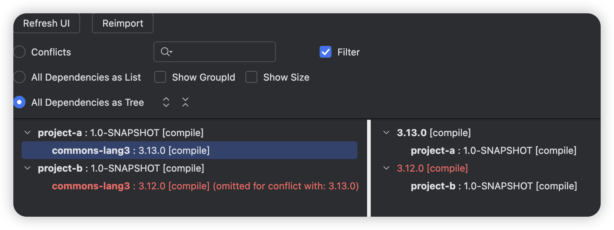
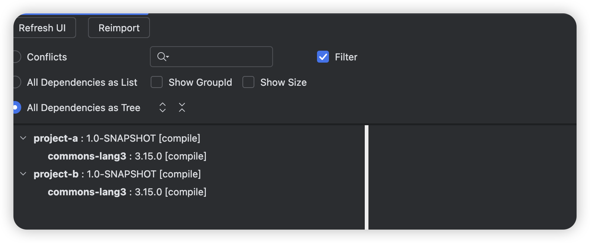
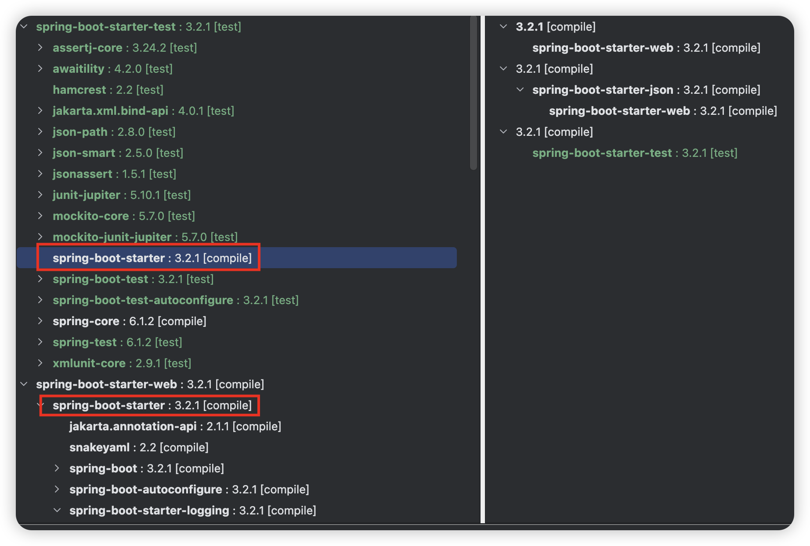
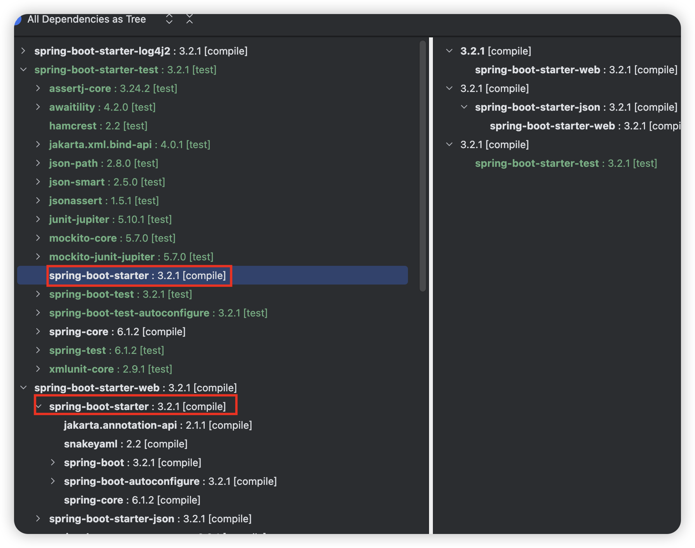
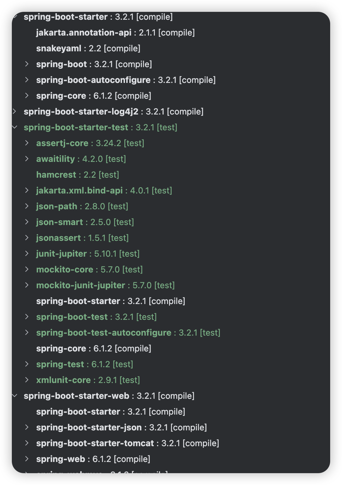

## 简介

Maven 处理依赖版本的核心，是在依赖树中**只保留一个版本**。当同一个 `groupId:artifactId` 出现多个版本时，Maven 依赖一套确定的仲裁机制来裁决，其核心逻辑可以概括为：**路径最短者优先，路径相同则先声明者优先。不过，这套自动仲裁机制可以被 `dependencyManagement` 或直接声明所覆盖。**

## 核心仲裁规则

### 最短路径优先

Maven 会选择**从项目根节点出发，路径长度最短**的那个版本。路径长度即依赖的层级深度。

- **直接依赖**（在 `pom.xml` 中显式声明）路径长度恒为 `1`。
- **传递依赖**的路径长度 ≥ `2`。

**示例**：项目直接依赖 `B`，`B` 传递依赖 `C:2.0`（路径 `项目→B→C`，长度为 2）；同时项目直接依赖 `D`，`D` 传递依赖 `E`，`E` 再传递依赖 `C:3.0`（路径 `项目→D→E→C`，长度为 3）。因为 `C:2.0` 的路径更短，所以最终 `C:2.0` 生效。

### 第一声明优先
当多个冲突版本的**路径长度完全相同**时，Maven 会选择在 `pom.xml` 的 `<dependencies>` 中**最先声明**的那个依赖版本。

**示例**：`项目→B→C:2.0` 和 `项目→F→C:3.0` 的路径长度都是 2。此时，如果 `B` 在 `pom.xml` 中比 `F` 先声明，那么 `C:2.0` 就会生效。

## 干预与覆盖机制：优先级更高的规则

上述仲裁规则只适用于“被动”传递进来的依赖。你可以在 `pom.xml` 中主动干预，它们的优先级高于自动仲裁。

### 直接声明（路径长度 = 1）

将依赖直接写入 `<dependencies>`，使其路径最短，从而在自动仲裁中胜出，(高于`dependencyManagement`)。

### dependencyManagement覆盖

在 `<dependencyManagement>` 中声明的版本拥有**最高决定权**，它会**覆盖**依赖调解（路径最短/先声明）的结果。即使一个传递依赖本身声明了版本，只要它的 `groupId:artifactId` 匹配 `dependencyManagement` 中的条目，就会强制使用托管版本。

```xml
<dependencyManagement>
    <dependencies>
        <dependency>
            <groupId>com.example</groupId>
            <artifactId>artifact-c</artifactId>
            <!-- 无论依赖树中传递进来的是何版本，都强制使用 3.0 -->
            <version>3.0</version>
        </dependency>
    </dependencies>
</dependencyManagement>
```

这是多模块项目统一依赖版本、避免冲突的最可靠方式。

## 排查命令

```bash
# 查看完整的依赖树
mvn dependency:tree
# 检查某个依赖，例如 spring-core
mvn dependency:tree -Dincludes=org.springframework:spring-core
# 使用 verbose 查看冲突详情
mvn dependency:tree -Dverbose
# 查看最终生效的 POM
mvn help:effective-pom
```

## 实际案例

### 场景一

假设有a、b两个项目，其中a项目依赖commons-lang3-3.13.0、b项目依赖commons-lang3-3.12.0。

此时项目c依赖于a和b，则会出现依赖冲突。

项目c的pom.xml

```xml
<dependencies>
  <dependency>
    <groupId>com.wangtao</groupId>
    <artifactId>project-a</artifactId>
    <version>1.0-SNAPSHOT</version>
  </dependency>
  <dependency>
    <groupId>com.wangtao</groupId>
    <artifactId>project-b</artifactId>
    <version>1.0-SNAPSHOT</version>
  </dependency>
</dependencies>
```

使用maven helper插件分析依赖，如下图所示。



项目b引用的commons-lang3-3.12.0与项目a引用的commons-lang3-3.13.0冲突，且被忽略。commons-lang3-3.13.0胜出。

因为路径长度是一样的(2个层级)，项目a的依赖在pom文件中的位置更靠前。

针对这种场景我们可以借助`<dependencyManagement>`来消除这种红色警告。

**只需要在项目c或者项目c的父pom中`<dependencyManagement>`加入版本声明即可，无需在`<dependencies>`明确声明依赖**

```xml
<dependencyManagement>
  <dependencies>
    <dependency>
      <groupId>org.apache.commons</groupId>
      <artifactId>commons-lang3</artifactId>
      <version>3.15.0</version>
    </dependency>
</dependencyManagement>
```

在maven-helper中点击Reimport按钮刷新下，可以看到红色警告没了，项目a和项目b引用的commons-lang3的版本都是3.15.0了



这种方式在spring boot starter中很常见，第三方的starter都会依赖`spring-boot-autoconfigure`依赖，但是当查看依赖树时发现版本和我们使用的spring boot版本是一致的，因为spring boot的pom中已经在`<dependencyManagement>`标签下声明了版本。

### 场景二

当多个项目a、b依赖**同一个依赖c的同一个版本时**，若是项目a先出现，则项目b的依赖树，只会到依赖c为止

比如spring-boot-starter这个依赖，它下面还依赖了很多别的依赖，比如spring-boot-starter-logging。

pom文件内容如下

```xml
<dependencies>
  <dependency>
    <groupId>org.springframework.boot</groupId>
    <artifactId>spring-boot-starter-web</artifactId>
  </dependency>
  <dependency>
    <groupId>org.springframework.boot</groupId>
    <artifactId>spring-boot-starter-test</artifactId>
    <scope>test</scope>
  </dependency>
</dependencies>
```

其中spring-boot-starter-web、spring-boot-starter-test都依赖了spring-boot-starter



可以看到spring-boot-starter-test中spring-boot-starter不会展开依赖树，只有它自己。

**为什么是spring-boot-starter-web中会展开，还是根据路径最短来确定的。**

当你想排除spring-boot-starter引用的spring-boot-starter-logging依赖，使用log4j2时，只需排除spring-boot-starter-web中的即可，不用担心spring-boot-starter-test还会间接引入spring-boot-starter-logging。

修改后的pom文件内容如下

```xml
<dependencies>
  <dependency>
    <groupId>org.springframework.boot</groupId>
    <artifactId>spring-boot-starter-web</artifactId>
    <exclusions>
      <exclusion>
        <groupId>org.springframework.boot</groupId>
        <artifactId>spring-boot-starter-logging</artifactId>
      </exclusion>
    </exclusions>
  </dependency>
  <dependency>
    <groupId>org.springframework.boot</groupId>
    <artifactId>spring-boot-starter-log4j2</artifactId>
  </dependency>
  <dependency>
    <groupId>org.springframework.boot</groupId>
    <artifactId>spring-boot-starter-test</artifactId>
    <scope>test</scope>
  </dependency>
</dependencies>
```



可以看到spring-boot-starter-web中引用的spring-boot-starter已经没有了spring-boot-starter-logging了。并且整个项目也没有spring-boot-starter-logging依赖了。

这里最好的做法是，显示声明spring-boot-starter依赖，这样路径是最短的，不用担心自己排除的不是那个最短的路径依赖了。

```xml
<dependencies>
  <dependency>
    <groupId>org.springframework.boot</groupId>
    <artifactId>spring-boot-starter-web</artifactId>
  </dependency>
  <!-- 显示声明spring-boot-starter，路径为1了，最短的 -->
  <dependency>
    <groupId>org.springframework.boot</groupId>
    <artifactId>spring-boot-starter</artifactId>
    <exclusions>
      <exclusion>
        <groupId>org.springframework.boot</groupId>
        <artifactId>spring-boot-starter-logging</artifactId>
      </exclusion>
    </exclusions>
  </dependency>
  <dependency>
    <groupId>org.springframework.boot</groupId>
    <artifactId>spring-boot-starter-log4j2</artifactId>
  </dependency>
  <dependency>
    <groupId>org.springframework.boot</groupId>
    <artifactId>spring-boot-starter-test</artifactId>
    <scope>test</scope>
  </dependency>
</dependencies>
```



可以看到spring-boot-starter-web、spring-boot-starter-test中的spring-boot-starter依赖都只有自己了。

### 场景三

项目有a b两个依赖，然后a b都依赖c，然后c本身依赖d，我在dependencyManagement中指定了c的版本，d的版本会怎样呢?

这个细节可以分两种情况讨论，在 `dependencyManagement` 中指定了 C 的版本，并不意味着 D 的版本也会被锁定。

假设依赖关系如下：

```txt
项目
├── A:1.0
│   └── C:1.0
│       └── D:1.0
└── B:1.0
    └── C:2.0
        └── D:2.0
```

项目配置

```xml
<dependencyManagement>
    <dependencies>
        <dependency>
            <groupId>com.example</groupId>
            <artifactId>C</artifactId>
            <version>3.0</version>
        </dependency>
    </dependencies>
</dependencyManagement>
```

假设 C 的 3.0 版本自身声明了：

```xml
<dependency>
    <groupId>com.example</groupId>
    <artifactId>D</artifactId>
    <version>3.0</version>
</dependency>
```

那么，项目最终会解析为：

```txt
项目
├── A:1.0
│   └── C:3.0
│       └── D:3.0
└── B:1.0
    └── C:3.0
        └── D:3.0
```

原因是：指定了 C:3.0，因此 A 和 B 传递引入的 C 都会使用 3.0。C:3.0 声明依赖 D:3.0，因此 D 的候选版本是 3.0。

注意，**这里 D 使用 3.0，是因为 C:3.0 自身声明了对 D:3.0 的依赖，而不是因为在 `dependencyManagement` 中指定了 C:3.0。**

若同时在 dependencyManagement 中指定 D 的版本

例如：

```
<dependencyManagement>
    <dependencies>
        <dependency>
            <groupId>com.example</groupId>
            <artifactId>C</artifactId>
            <version>3.0</version>
        </dependency>

        <dependency>
            <groupId>com.example</groupId>
            <artifactId>D</artifactId>
            <version>4.0</version>
        </dependency>
    </dependencies>
</dependencyManagement>
```

即使 C:3.0 声明依赖 D:3.0，项目最终解析时，D 也会使用受管理的版本 4.0。

依赖树可以理解为：

```
项目
├── A:1.0
│   └── C:3.0
│       └── D:4.0
└── B:1.0
    └── C:3.0
        └── D:4.0
```

这里 D:4.0 是由项目的 `dependencyManagement` 管理的。

**`dependencyManagement` 对每个依赖坐标分别进行版本管理。管理 C 的版本，不会自动锁定 C 的传递依赖 D 的版本。**

如果你想统一管理整条依赖链，通常需要通过 BOM 或在 `dependencyManagement` 中分别声明相关依赖的版本。